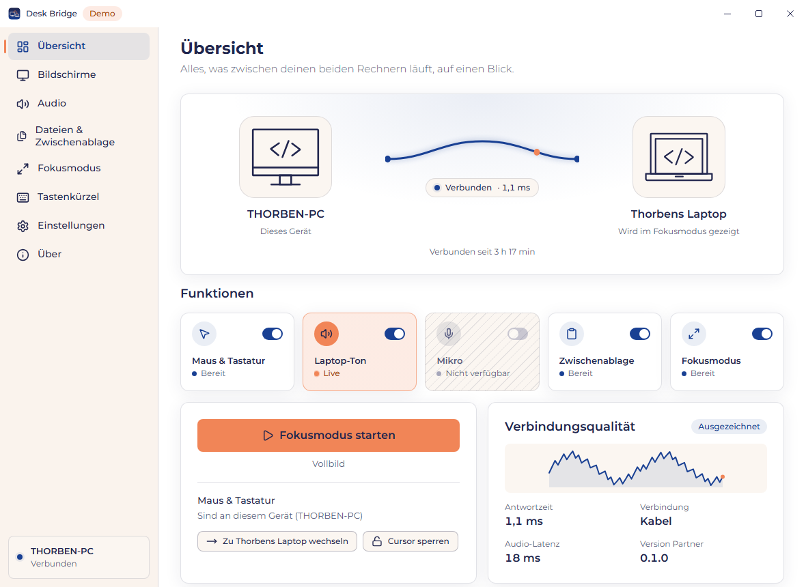
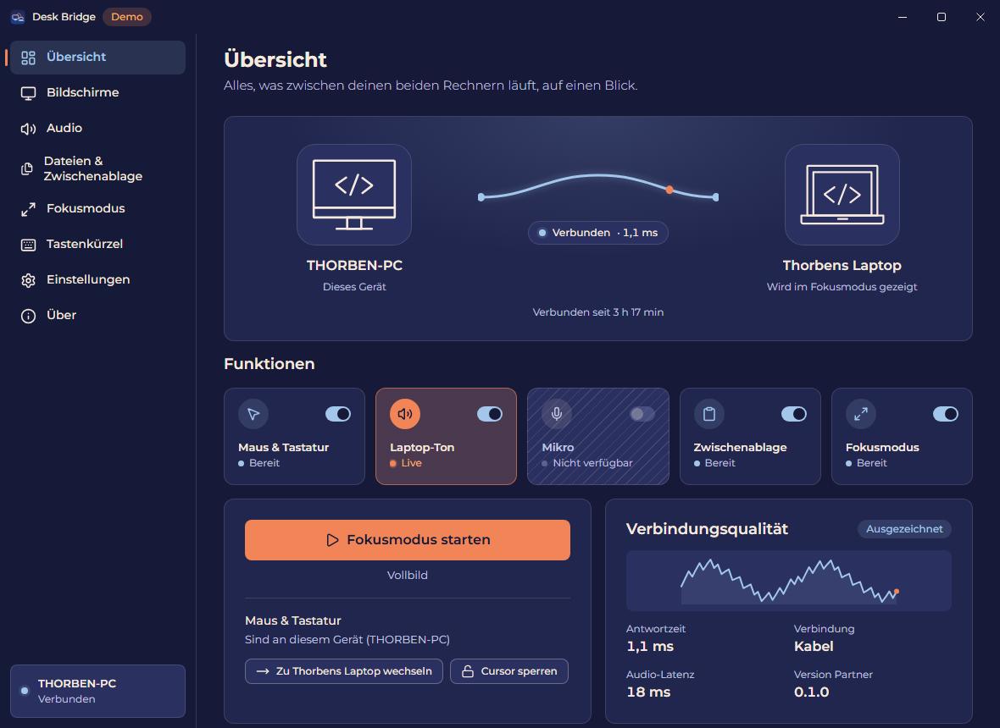
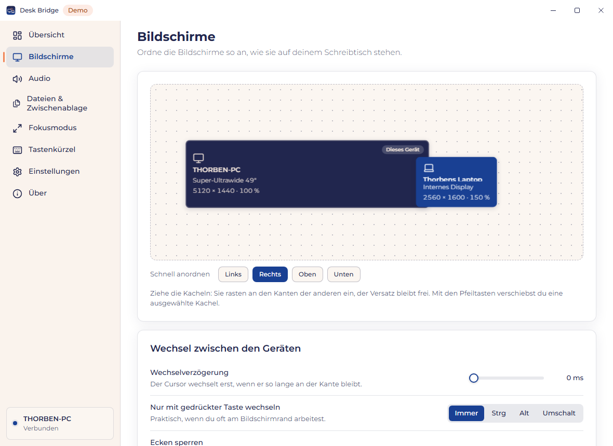
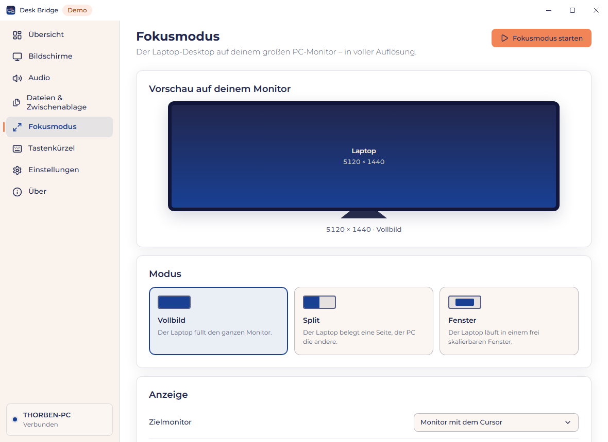

# Desk Bridge

**Ein Schreibtisch. Zwei Rechner. Null Umschalten.**

One desk, two computers, zero switching. Install Desk Bridge on both Windows machines, pair them
once with a six-digit code, and your mouse, keyboard, clipboard, files and headset work across both.
Everything stays on your LAN: encrypted end to end, no cloud, no account, no telemetry.

> By [softwelop](https://softwelop.com). Licensed under MIT OR Apache-2.0.

## What it does

| | Feature |
|---|---|
| F1 | **Share mouse and keyboard.** Push the mouse over the screen edge and you control the laptop; it behaves like one more monitor. |
| F2 | **Laptop sound in your headset**, mixed with the PC sound. |
| F3 | **Headset microphone for the laptop** for Teams, Zoom, Discord through the free [VB-CABLE](https://vb-audio.com/Cable/) driver (install it on the laptop yourself, see [ADR 0003](docs/adr/0003-virtual-audio-driver.md)). Desk Bridge switches "CABLE Output" on while your headset mic is in use and off otherwise, so apps fall back to the laptop microphone. |
| F4 | **Shared clipboard**: text, rich text, images, files. |
| F5 | **Send files** with copy/paste in Explorer, drag and drop, or "Send to". |
| F6 | **Focus mode**: the laptop full screen (or half) on your ultrawide in native 5120x1440 at 120 Hz through a virtual display. |
| F7 | **A simple, good-looking UI** in softwelop branding: install, pair, go. |

One installer does everything: driver, firewall rule, autostart, no manual prerequisites.

## Screenshots

<p align="center">
  
  
</p>
<p align="center">
  
  
</p>

(Rendered from the UI's built-in mock agent.)

## Status

Feature complete in code for all milestones of [`docs/PLAN.md`](docs/PLAN.md); everything that needs
real hardware (two PCs, the headset dongle, the RTX laptop, UAC/lock screen, drivers) is covered by
the checklists in [`docs/testing.md`](docs/testing.md) and has to be signed off there.

| Milestone | Code | Hardware sign-off |
|---|---|---|
| M0 Foundation (workspace, UI shell, installer, CI) | done | installer on a clean machine |
| M1 Connection (identity, pairing, QUIC, reconnect) | done, tested on loopback | sleep/wake, 24 h |
| M2 Mouse, keyboard, text clipboard | done, tested with mocks | real hooks/injection, week of daily use |
| M3 Audio (laptop sound to headset) | done | latency, dongle hot-plug |
| M3b Virtual microphone | done with VB-CABLE (user-installed), automatic on/off and default device | Teams call |
| M4 Clipboard and files | done | Explorer copy dialog, 2 GB file |
| M5 Focus mode | done, pipeline tested with a synthetic backend | 5120x1440@120 on the laptop |
| M6 Service, diagnostics | done | UAC / lock screen |
| M7 Release preparation | done | signing, project page |

Platform: Windows 10 22H2+ and Windows 11 (x64). macOS and Linux later.
Download: [GitHub releases](https://github.com/auerth/desk_bridge/releases). Desk Bridge tells you
when a newer release is out (nothing is installed automatically). Changes: [CHANGELOG.md](CHANGELOG.md).

## Quick start (developers)

```powershell
git clone https://github.com/auerth/desk_bridge.git
cd desk_bridge
cd app; npm ci; npm run build; cd ..       # the Tauri crate embeds app/dist
cargo test --workspace
.\scripts\dev-two-instances.ps1 -Clean      # two agents on this PC for development
```

Build the installer: `.\scripts\stage-installer.ps1 -NoFfmpeg`, then `cd app; npm run tauri build -- --bundles nsis`.
Full instructions (cmake for libopus, mock mode, deploy to a laptop): [docs/development.md](docs/development.md).

## Documentation

* [Plan](docs/PLAN.md) - vision, requirements, milestones (German)
* [Architecture](docs/architecture.md) - processes, crates, threading, state machines
* [Protocol](docs/protocol.md) - QUIC channels, framing, pairing
* [Testing](docs/testing.md) - automated tests and the hardware checklists
* [Decisions (ADRs)](docs/adr/README.md)
* [Installer](installer/README.md)

## Contributing and security

Contributions are welcome, see [CONTRIBUTING.md](CONTRIBUTING.md). Please report vulnerabilities
privately through GitHub (Security tab, "Report a vulnerability"), not as a public issue.

## License

Dual-licensed under [MIT](LICENSE-MIT) or [Apache-2.0](LICENSE-APACHE), at your option. Bundled
third-party components keep their own licences (FFmpeg LGPL build as DLLs, Montserrat under the
SIL OFL, drivers under the licences in `drivers/*/`).
