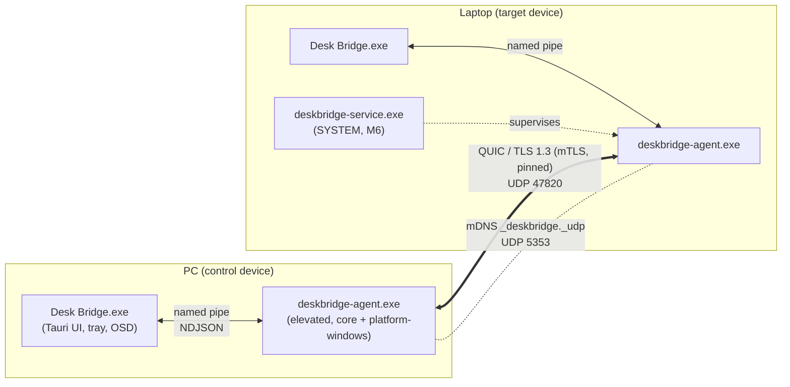
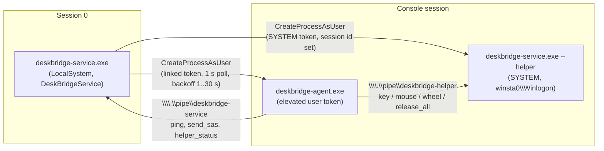
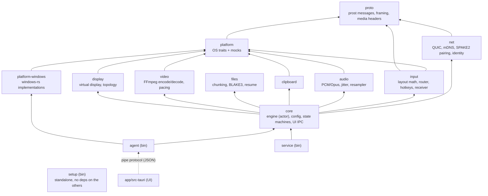
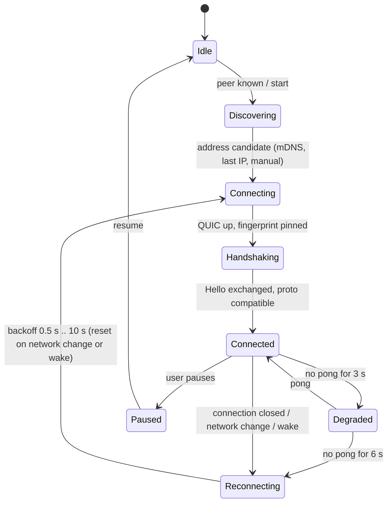
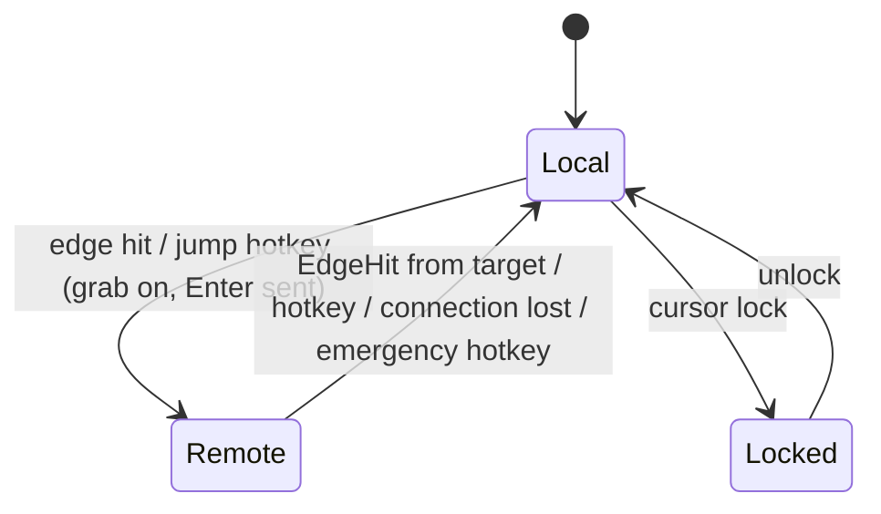
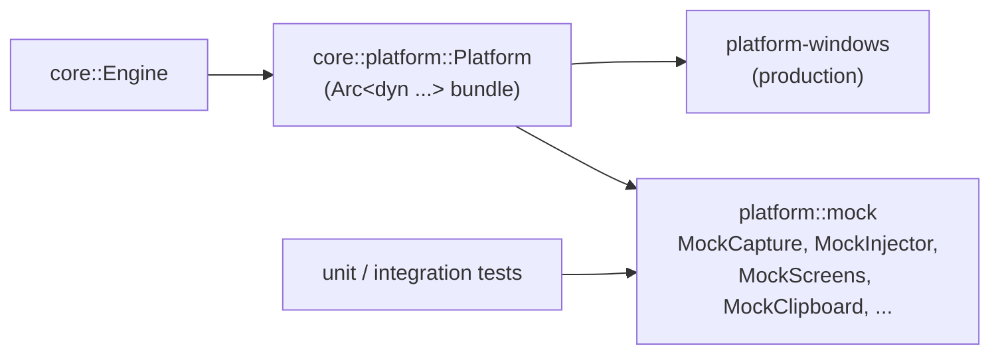
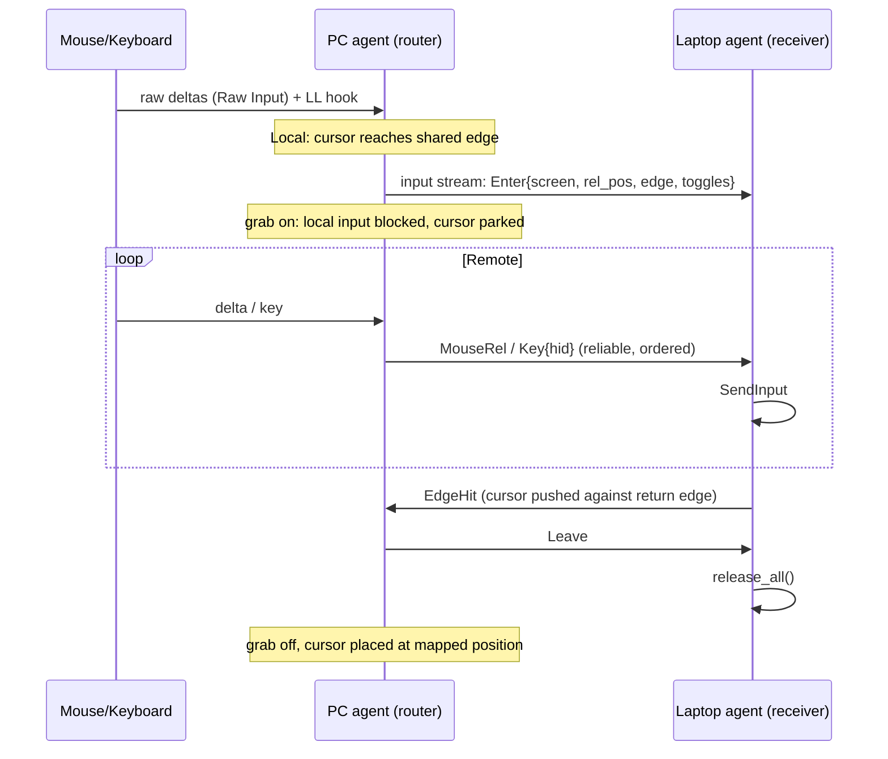

# Architecture

> Source of truth for *what* we build is [`PLAN.md`](PLAN.md). This document describes *how* the code
> is organised today. If the two disagree, the plan wins and this file gets fixed. Changes of
> direction need an ADR in [`docs/adr/`](adr/README.md).

## 1. Big picture

Both computers run the same software. Roles are per capability, not per machine:

| Role | Meaning | v1 |
|---|---|---|
| Input source | the machine mouse and keyboard are plugged into | PC |
| Audio sink | the machine with the headset | PC |
| Stream source | the machine that is shown in focus mode | Laptop |

## 2. Processes

| Process | Runs as | Job | Since |
|---|---|---|---|
| `deskbridge-agent.exe` | user session, **elevated** (scheduled task *DeskBridge Agent*, run level highest, no UAC prompt) | the product: network, input, audio, clipboard, files, capture/encode, decode/render | M1 |
| `Desk Bridge.exe` | user session, normal | UI, tray, OSD; talks to the agent over `\\.\pipe\deskbridge-ui` (ACL: current user) | M0 |
| `deskbridge-service.exe` | Windows service (SYSTEM) | starts/supervises the agent, secure-desktop helper (UAC, lock screen), `SendSAS`, watchdog (`release_all` on agent crash) | M6 |
| `deskbridge-setup.exe` | elevated, short-lived | installer helper: firewall rule, scheduled task, SendTo shortcut, driver store/devices, uninstall | M0 |

Why agent and UI are separate: the UI may crash or be closed without mouse and audio dropping out,
and only the agent needs the elevated token (UIPI: a non-elevated process cannot inject input into
elevated windows). During M0/M1 the agent may be embedded in the UI process (`embedded-agent`
feature); the crate layout already keeps `core` a library.

Environment overrides honoured by the agent (used by `scripts/dev-two-instances.ps1` and tests):

| Variable | Effect |
|---|---|
| `DESKBRIDGE_DATA_ROOT` | all config/data below `<root>\config` and `<root>\data` instead of `%APPDATA%` / `%LOCALAPPDATA%` (`AppPaths::under`) |
| `DESKBRIDGE_PORT` | UDP port of the QUIC listener (default 47820) |
| `DESKBRIDGE_PIPE` | full name of the UI pipe (default `\\.\pipe\deskbridge-ui`) |

### 2.1 Service, secure-desktop helper and pipes (M6)

Design, risks and rejected options: [ADR 0006](adr/0006-service-and-secure-desktop.md).

* **Supervisor** (service): once per second looks at the console session (`WTSGetActiveConsoleSessionId`
  + user name). Never starts a second agent: the agent's mutex `Global\softwelop-deskbridge-agent`
  and a process lookup decide. After a logon the scheduled task gets 20 s; after a crash the agent
  is restarted with 1, 1, 2, 4 ... 30 s backoff (reset after 60 s of healthy running). Exit code 0
  (user quit the agent) is respected. The crash exit code is logged to
  `%ProgramData%\softwelop\DeskBridge\logs\service.log.<date>`; the restarted agent calls
  `release_stuck_keys()` (target devices only) before doing anything else.
* **Helper**: injects with the same `WinInputInjector` as the agent, on a dedicated thread that
  follows the input desktop (`OpenInputDesktop` + `SetThreadDesktop`). When the agent connection
  drops, the helper releases all keys itself.
* **Agent side** (`crates/agent/src/secure.rs`): `SecureDesktopInjector` probes the input desktop
  (cached 100 ms; name != `Default` or access denied means secure) and routes to the normal
  injector or the helper pipe, releasing everything on the side it leaves. `ServiceClient`
  implements `SystemServices` for `M::SendSas` (Ctrl+Alt+End on the PC).
* **Pipes** are protected by DACL (SYSTEM + the console user's SID, remote clients rejected) plus a
  High-integrity mandatory label, so a non-elevated process of the same user cannot use the SYSTEM
  helper to bypass UIPI. The wire format is `crates/service/src/protocol.rs` (length-prefixed
  binary; injection commands have no response).
* `deskbridge-service.exe --console [--no-sas] [--no-agent] [--no-helper]` runs the same logic in
  the foreground without the SCM (needs SYSTEM, e.g. via `psexec -s`).
* `SendSAS` needs the policy `HKLM\SOFTWARE\Microsoft\Windows\CurrentVersion\Policies\System\SoftwareSASGeneration`
  = 1 (or 3). Without it the service refuses the request (error shown in the UI) instead of
  silently doing nothing; the service logs the `reg add` command that enables it.

## 3. Crates

| Crate | Responsibility | Windows-free? |
|---|---|---|
| `proto` | `deskbridge.proto` (package `deskbridge.v1`), `u32 LE` length framing, audio/video binary headers, ALPNs, protocol version | yes |
| `net` | identity + self-signed Ed25519 cert, `peers.toml`, rustls pinning, SPAKE2 pairing, QUIC `Transport`/`SessionConn`, mDNS | yes |
| `platform` | traits for every OS interface (`InputCapture`, `InputInjector`, `ScreenProvider`, `ClipboardBackend`, `AudioCapture`, `AudioPlayback`, `VirtualAudio`, `ScreenCapturer`, `VideoEncoder/Decoder/Presenter`, `DisplayManager`, `PowerManager`, `SecretProtector`) and `platform::mock` | yes |
| `platform-windows` | the Windows implementations (hooks, Raw Input, `SendInput`, WASAPI, clipboard, DXGI, `QueryDisplayConfig`, power broadcast, DPAPI) | no (by design the only place) |
| `input` | shared layout and edge mapping, source-side router (local/remote), hotkey engine, target-side receiver with key-state tracking (`release_all`) | yes |
| `audio` | f32/48 kHz pipeline, PCM and Opus, adaptive jitter buffer, `rubato` drift control, level meters | yes |
| `clipboard`, `files` | format mapping/loop guard, chunked transfer, resume, BLAKE3 | yes |
| `video`, `display` | capture-encode-decode pipeline and pacing; virtual display and topology save/restore | yes (traits) |
| `core` | the **engine**: one actor that owns all state; config, connection and focus state machines, UI IPC server | yes |
| `agent` / `service` | thin binaries wiring `core` to `platform-windows` | binary only |
| `setup` | installer helper; deliberately has **no dependency** on the other crates (only a unit test keeps `brand.rs` constants in sync) | no |

Rule: no Windows type leaves `platform-windows` (plan 17). Keys travel as USB-HID usage codes,
coordinates as physical pixels (+ DPI), audio as f32/48 kHz, clipboard formats as MIME types.

## 4. Threading model

* **tokio multi-thread runtime** for networking, timers, IPC and the engine.
* **Engine = actor.** `core::engine::Engine` owns every piece of mutable state. Network tasks,
  capture forwarders, the IPC server, timers and power events never touch state; they send a
  `Msg` (`Ui`, `Accepted`, `SessionReady`, `PeerControl`, `PeerInput`, `Capture`, `Clipboard`,
  `Power`, `Tick`, ...) over an unbounded channel. State changes are pushed to the UI as full
  snapshots (throttled).
* **Per session**: a writer task per outgoing stream (control, input) fed by a channel, a reader
  task per incoming stream, datagram readers/writers for audio.
* **OS threads** (inside `platform-windows`, hidden behind the traits):
  * low-level hook thread with a message loop (`WH_MOUSE_LL`, `WH_KEYBOARD_LL`). The hook callback
    only enqueues into a lock-free channel, otherwise Windows removes the hook after
    `LowLevelHooksTimeout`.
  * Raw Input window thread for deltas and precision scrolling.
  * WASAPI event-driven capture/render threads (high priority, MMCSS) writing into ring buffers.
  * clipboard listener window (`AddClipboardFormatListener`), display-change/power window.
  * focus mode (M5): capture, encode, send as separate pipeline threads (8.3 ms budget at 120 Hz).
* **Time**: all timestamps are microseconds on the sender's monotonic clock; `core::clock` keeps a
  `ClockSync` offset from ping/pong so latency can be measured without synchronised clocks.

## 5. State machines

Implemented in `core` (connection) and `input` (routing); focus mode follows in M5.

### Connection

Heartbeat: ping every 500 ms; session keep-alive 1 s; idle timeout 10 s. The device with the larger
id dials first; the other waits 2 s (avoids double connections), a duplicate is resolved by
closing the loser with `close::DUPLICATE`.

### Input focus (source side, `input::router`)

Safety rule: **every** exit from `Remote` makes the *target* call `release_all()` (key-up for every
key and button it injected, tracked by the receiver) and the source lift the grab. Stuck keys must
never happen; tests cover connection loss while a key is held.

### Focus mode (M5, planned)

`Off -> Preparing (virtual display on, topology saved) -> Streaming -> Stopping (topology restored) -> Off`,
every step with timeout and rollback; the topology is also written to `topology.json` so the next
agent start can recover from a crash.

## 6. Platform traits and mocks

`Platform::mock(w, h)` returns the bundle plus handles to drive and inspect the mocks (feed capture
events, read what was injected, change screens). Integration tests start two `Engine`s with mock
platforms bound to `127.0.0.1` and real QUIC between them: pairing, reconnect, edge switching,
"connection lost while a key is down", clipboard. No hardware and no admin rights are needed, so
the whole stack runs in CI. Anything that really needs hardware is in
[`testing.md`](testing.md) as a manual checklist.

## 7. Data flow examples

### Mouse crosses the edge (PC to laptop)

### Audio (laptop sound to headset)

Laptop: WASAPI loopback (later: virtual speaker endpoint) -> f32/48 kHz -> PCM or Opus (auto) ->
`AudioPacket` datagrams (QUIC unreliable). PC: adaptive jitter buffer (5-60 ms) -> `rubato`
drift correction (+-0.2 %) -> WASAPI shared render on the headset device. Silence is sent as
keep-alive packets only.

## 8. Persistence and trust

* Identity (`identity.bin`, DPAPI-protected key), `peers.toml` (id, name, SHA-256 fingerprint, last
  address), `config.toml` (schema-versioned): `%APPDATA%\softwelop\DeskBridge`.
* Logs, `Incoming\`, `topology.json`, `lid-backup.json`: `%LOCALAPPDATA%\softwelop\DeskBridge`.
* Trust is pinned certificates only. The TLS layer accepts any certificate but checks handshake
  signatures; the application layer then compares the SHA-256 fingerprint with `peers.toml`
  (session ALPN) or binds it into the SPAKE2 confirmation (pairing ALPN). Details:
  [`protocol.md`](protocol.md).

## 9. Installer layer

`Desk Bridge-Setup.exe` (Tauri NSIS) -> hooks (`installer/hooks.nsh`) -> `deskbridge-setup.exe`
(firewall rule `Desk Bridge (UDP 47820 + mDNS)`, task `DeskBridge Agent`, SendTo shortcut,
driver catalogue, `installed.json`) -> UI launch. Uninstall reads `installed.json`, restores the
lid action from `lid-backup.json` and optionally deletes user data. See
[`installer/README.md`](../installer/README.md).
