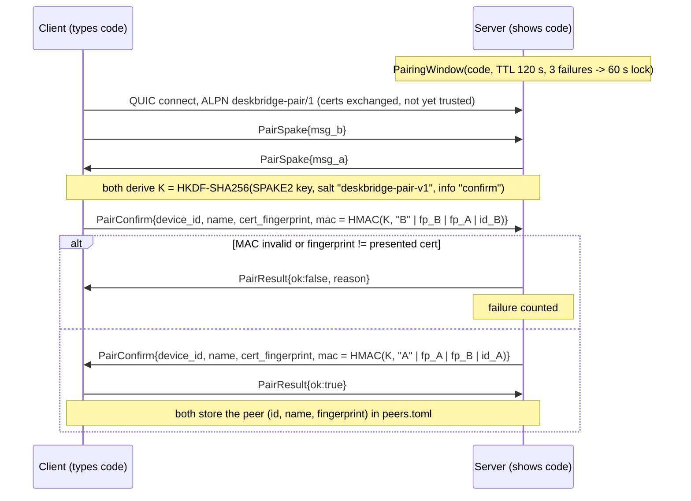

# Desk Bridge peer protocol

Version **1.0** (`PROTO_MAJOR = 1`, `PROTO_MINOR = 0`). Authoritative sources:
[`crates/proto/proto/deskbridge.proto`](../crates/proto/proto/deskbridge.proto),
`crates/proto/src/{lib,frame,media}.rs`, `crates/net/src/{transport,pairing,tls}.rs`. This document
explains them; when code and document differ, the code is right and this file needs a fix.

## 1. Transport

* **QUIC** (RFC 9000, `quinn` + `rustls`, TLS 1.3, `ring` provider) over **one UDP port**, default
  **47820** (`DESKBRIDGE_PORT` overrides it for development).
* Keep-alive 1 s, idle timeout 10 s, 4 MiB datagram buffers. Datagram support is mandatory.
* Every device owns a self-signed **Ed25519** certificate (SAN `deskbridge`) created at first start;
  the SHA-256 of its DER encoding is the **fingerprint**. The SNI used for every connection is the
  fixed string `deskbridge`; it carries no trust.
* **mTLS with pinning.** Both sides send certificates. The TLS verifier accepts any certificate but
  still verifies the handshake signatures (proof that the peer owns the key). Trust is decided right
  after the handshake and **before any application byte** is processed:
  * session ALPN: the peer fingerprint must be in `peers.toml`; otherwise the connection is closed
    with code `0x403` (unknown peer);
  * pairing ALPN: see section 3.
* There is never an unencrypted mode.

### ALPNs

| ALPN | Purpose |
|---|---|
| `deskbridge/1` | normal session between paired devices |
| `deskbridge-pair/1` | pairing, certificates not yet trusted; only accepted while a pairing window is open |

A different ALPN (including a future `deskbridge/2`) is closed with code `0x426` (version).

### Close codes (QUIC application error)

| Code | Meaning |
|---|---|
| `0` | normal / shutdown |
| `0x403` | unknown peer / fingerprint mismatch / device id mismatch |
| `0x409` | duplicate connection (both sides dialled; the loser is closed) |
| `0x426` | incompatible protocol version or ALPN |

### Discovery (mDNS)

Service type `_deskbridge._udp.local.`, instance label derived from the device name, port = QUIC
port. TXT records: `id` (device UUID), `name`, `ver` (app version), `proto` (`proto_version`).
Fallbacks: last known IP/port from `peers.toml`, manually entered host/IP.

## 2. Channels

| Channel | QUIC primitive | Direction | Content | Reliability |
|---|---|---|---|---|
| control | bidi stream #0 (opened by the initiator) | both | `Control` envelope: Hello, Ping/Pong, layout, focus, audio control, clipboard/file control, updates | reliable, ordered |
| input | bidi stream #1 (opened by the initiator; first byte `0x49` so the acceptor sees it) | both | `InputEvent` | reliable, ordered: a lost key-up would mean a stuck key |
| audio | **datagrams** | both | `AudioPacket` (12-byte header + payload) | unreliable on purpose: loss beats delay |
| clipboard data | uni stream per transfer, first byte `0x01` | sender to receiver | `ClipboardDataHeader` then raw bytes | reliable |
| files | uni stream per file, first byte `0x02` | sender to receiver | `FileHeader`, raw chunks (256 KiB), `FileTrailer` (BLAKE3) | reliable, parallel (max 4), resumable |
| video | uni stream per frame, first byte `0x03` | stream source to viewer | `VideoHeader` + encoded frame | a late frame is dropped, then `KeyframeRequest` |

Uni streams carry a one-byte *kind* before their payload; unknown kinds are dropped by the receiver.
Datagrams are sent with `send_datagram` and limited by `max_datagram_size()`.

### Framing (control, input, file/clipboard headers, pairing)

```
+----------------+----------------------------+
| u32 LE length  | protobuf message (length B)|
+----------------+----------------------------+
```

* `MAX_FRAME` = 8 MiB; larger frames are a protocol error and close the stream.
* A clean EOF on a frame boundary is `Closed`; EOF inside a frame is an I/O error.
* Unknown protobuf fields are ignored (tested), unknown `oneof` variants are skipped.
* Bulk payloads (clipboard bytes, file chunks, video) are **raw** after their framed header.

### Media headers (little endian)

Audio datagram, 12 bytes:

```
stream_id u8 | flags u8 | seq u16 | ts_us u64 | payload...
stream_id: 1 = target -> headset device (laptop sound), 2 = headset microphone -> target
flags:     bit0 = Opus (else raw s16le PCM), bit1 = silence keep-alive (empty payload), bit2 = mono
```

Video frame, 17 bytes at the start of the uni stream (after the kind byte):

```
frame_id u32 | flags u8 | width u16 | height u16 | ts_us u64 | payload...
flags: bit0 = key frame, bit1 = keep-alive (nothing changed, show previous picture),
       bits 4..5 = codec (1 H.264, 2 HEVC, 3 AV1)
```

`ts_us` is microseconds on the sender's monotonic clock; the receiver converts using the offset
from ping/pong.

## 3. Pairing (`deskbridge-pair/1`)

Roles: the device that **shows** the 6-digit code is the pairing *server* (SPAKE2 side A); the
device where the code is typed is the *client* (side B).



The MACs cover *both* certificate fingerprints as seen by the sender, so a man in the middle, who
necessarily presents different certificates on each leg, fails verification. The SPAKE2 identities
are the fixed strings `deskbridge-shows-code` (A) and `deskbridge-enters-code` (B). After pairing
all connections use the session ALPN with pinned fingerprints. Unpairing deletes the peer on both
sides.

## 4. Session start

```mermaid
sequenceDiagram
  participant I as Initiator
  participant R as Responder
  I->>R: QUIC connect (ALPN deskbridge/1, expected fingerprint from peers.toml)
  Note over I: fingerprint != pinned -> close 0x403
  Note over R: peer fingerprint not in peers.toml -> close 0x403
  I->>R: open bidi #0 (control): Control{Hello}
  I->>R: open bidi #1 (input): 0x49
  R->>I: Control{Hello}
  Note over I,R: 5 s timeout for the whole exchange.<br/>proto major differs -> close 0x426.<br/>Hello.device_id != pinned peer id -> close 0x403.
  loop every 500 ms
    I->>R: Control{Ping{t0}}
    R->>I: Control{Pong{t0, t1}}
  end
  Note over I,R: RTT and clock offset from t0/t1; 3 s without pong = Degraded, 6 s = drop and reconnect
  I->>R: LayoutUpdate / ScreensUpdate as needed
```

Which device dials: the device with the larger id dials first; the smaller one waits 2 s. If both
connect anyway, the duplicate is closed with `0x409`.

`Hello` fields: `device_id`, `name`, `os`, `app_version`, `proto_version` (`major << 16 | minor`),
`caps` (list of `{name, version}`), `screens`, `video` (`VideoCaps`: encode/decode codecs, 4:4:4,
max size/fps, encoder name). Well-known capability names live in `deskbridge_proto::caps`
(`input`, `clipboard.text`, `clipboard.rich`, `files`, `files.virtual`, `audio.pcm`, `audio.opus`,
`audio.speaker-source`, `audio.mic-sink`, `audio.headset`, `focus.source`, `focus.viewer`, `update`,
`update.remote`, `logs`).

### Input stream

`InputEvent{ts_us, oneof ev}`: `Key{hid, down}` (USB HID usage page 0x07, so layouts map per OS),
`MouseRel`, `MouseAbs` (normalised 0..1 per screen, for focus mode), `MouseButton` (1 left, 2 right,
3 middle, 4 X1, 5 X2), `Wheel` (120 = one notch), `Enter{screen_id, rel_pos, edge, toggles}`,
`Leave`, `EdgeHit{screen_id, edge, rel_pos}` (from the target when the cursor pushes against the
return edge), `ToggleState` (Caps/Num/Scroll lock sync) and `ReleaseAll`. **Leaving the remote
state always results in `release_all()` on the target.**

### Control messages by area

| Area | Messages |
|---|---|
| Liveness | `Ping`, `Pong`, `Goodbye`, `ErrorMsg` |
| Layout | `LayoutUpdate{placements, revision}`, `ScreensUpdate` |
| Focus mode | `FocusStart{width,height,fps,codec,bitrate_kbps,yuv444,layout,disable_internal_display}`, `FocusReady`, `FocusFailed`, `FocusStop`, `KeyframeRequest`, `BitrateHint`, `CursorShape`, `CursorPos`, `StreamStats` |
| Audio | `AudioRoute{stream, enabled}`, `MicInUse{in_use, process}`, `AudioCodecChoice` |
| Clipboard | `ClipboardOffer{id, formats, files, inline_text}`, `ClipboardRequest`, `ClipboardClear` (+ data on a uni stream) |
| Files | `SendFiles`, `FileRequest{transfer_id, index, offset}`, `TransferProgress` |
| Update | `UpdateOffer{version, size, sha256, install}`, `UpdateAnswer{accept, reason}`, `UpdateRequest`, `UpdateStatus{version, error}` |

Partner updates: the sender offers an installer (`UpdateOffer`), the partner answers
(`UpdateAnswer`) and the file follows as a normal transfer (hint `update:<version>:<sha256>`,
verified on arrival). With `install` set (only towards a newer version, capability
`update.remote`) the partner accepts without a dialog when its setting
`update.allow_partner_install` allows it or it asked for the update itself (`UpdateRequest`),
starts the installer (`/P`) and reports the outcome with `UpdateStatus`; the installation ends the
connection, which comes back with the new version. A partner without `update.remote` ignores
`install` and asks its user.

Text under 1 MiB is sent eagerly inside `ClipboardOffer.inline_text`; everything else is offered
(delayed rendering) and fetched on paste with `ClipboardRequest`. Offers marked sensitive are never
sent.

## 5. Versioning rules

1. `proto_version = major << 16 | minor`. Peers with the **same major** talk to each other; the
   usable feature set is the intersection of `caps`. A different major closes the session with
   `0x426`, and the UI shows "Bitte beide Geräte aktualisieren".
2. Within a major version only **additive** changes are allowed: new fields with new tags, new
   `oneof` variants, new capabilities, new enum values (enums must have an `_UNSPECIFIED = 0`).
   Never reuse or renumber a tag, never change a field's type; mark removed fields `reserved`.
3. Receivers ignore unknown fields and unknown `oneof` variants. New behaviour is gated behind a
   capability, never behind "the version is newer".
4. Bump minor when adding capabilities, major only for incompatible changes (new ALPN
   `deskbridge/2`; during a transition a device may offer both).
5. Add a compatibility test (old decoder on new bytes and vice versa) for every new message; see the
   unknown-field test in `proto::frame`.
6. UI protocol (agent to UI, newline-delimited JSON on `\\.\pipe\deskbridge-ui`) is separate and
   internal: the UI and agent are always installed together. See `crates/core/src/ipc.rs`.
